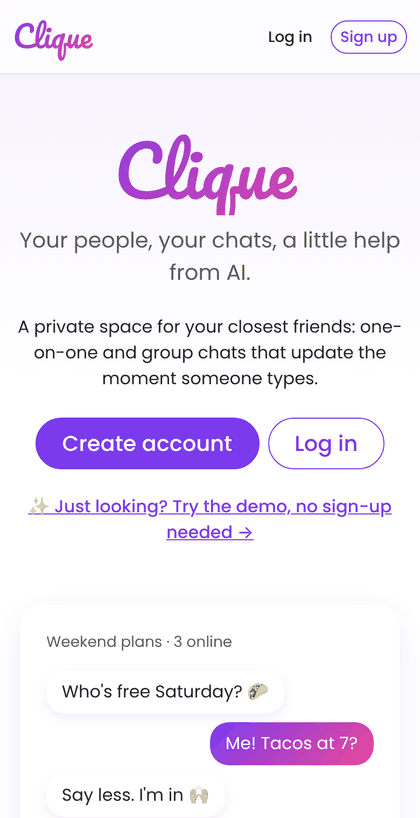
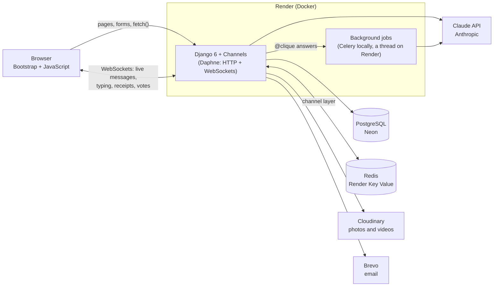

# Clique

*Your people, your chats, a little help from AI.*

Clique is a private messaging app for close friends: real-time private and group chats, photos and videos, polls, and a built-in AI assistant (Claude) that catches you up, writes replies for you and plans hangouts, but only when you ask.

**🔗 Live demo: https://clique-qe18.onrender.com**: tap **✨ Try the demo** to get your own guest account with friends, chats and a poll already in it. No sign-up needed.
*(Free hosting: the first visit after a quiet spell can take up to a minute while the server wakes up.)*

<p align="center">
  
</p>

## Features

**Messaging**
- Private and group chats with group admins, renaming, adding and removing people
- **Real-time over WebSockets:** messages, edits and deletes appear instantly, plus "… is typing", "Seen" read receipts, online status and a live inbox with unread counts
- **Photos and videos**, uploaded with a progress bar, stored on Cloudinary, plus a media tab per chat
- **Polls:** tap to vote, change your mind, and watch the counts update live for everyone
- Friends, friend requests and blocking; profile photos; password reset by email

**Clique AI (Claude API)**

| Feature | What it does |
|---|---|
| ✨ **Catch me up** | Missed 10+ messages? One tap summarizes them in a few bullet points |
| ✍️ **Write it for me** | One tap writes your next message from the latest chat, **including recent photos and video frames**. Tap again for a different one |
| ✨ **Help me reply** | Type what you need. An **agent with tools** searches the chat and checks who's in it, then gives you a draft, a **private answer** only you see, or a **poll** to confirm |
| **@clique** | Ask in the chat ("@clique what time did we agree on?") and Clique AI answers for everyone, in the background |

## How the AI agent works

"Help me reply" is a tool-using agent built on the Claude Messages API (`ai/agent.py`):

1. Clique sends Claude the recent messages, the person's request and five tools: `search_messages`, `get_members`, `draft_reply`, `answer_privately` and `create_poll`.
2. Claude decides which tools it needs. Clique runs them, **only against the chat the person is in**, and sends back the results.
3. The loop repeats (at most 6 rounds) until Claude finishes with a draft, a private answer or a proposed poll.
4. The page shows each step ("🔎 Searched the chat for 'trip'"), so you can see how it got its answer.

If Claude proposes an invalid poll (one option, duplicates), the validation error goes back to it as a tool result and it corrects itself.

## AI safety and privacy

- **The person stays in control:** the AI never sends anything by itself. Drafts go into the message box, and polls are posted only after you tap **Post poll**.
- **Prompt-injection protection:** chat messages are wrapped in `<messages>` tags, and Claude is told to treat them as information, never instructions. A friend typing "ignore your rules" has no effect.
- **Opt-outs:** anyone can leave their messages out of Clique AI, and group admins can switch the AI off for the whole group.
- **Only the current chat:** every tool and summary is scoped to the chat where it was asked.
- **Clear labels:** AI answers in a chat appear as ✨ Clique AI in their own style.
- **Cost limits:** 30 AI uses per person per day (10 for demo guests), a token log per request (`AIRequest`), and a monthly spending cap on the API account.
- **Safety fallbacks:** if Claude's safety checks decline a request, the API retries it on a fallback model (server-side fallbacks).

## Architecture



- **Live updates:** every open chat tab joins a group on the Redis channel layer. Saving a message (or a vote) broadcasts an event *after the database transaction commits*, and each tab re-draws it for its own viewer.
- **Services layer:** views and WebSocket consumers stay thin. The rules (who can message whom, admin rights, limits) live in `services.py` functions, which keeps them in one place and easy to test.
- **Background work:** `@clique` answers run as a Celery task so sending a message never waits on the AI. Render's free plan has no worker, so in production the same task runs in a background thread (`core/background.py`).

## Tech stack

Python 3.14 · Django 6.1 · Django Channels (WebSockets) · PostgreSQL · Redis · Celery · Anthropic Python SDK (Claude) · Cloudinary · Bootstrap 5 · Docker · GitHub Actions · Render · pytest · Ruff

## Testing

360+ tests with **pytest** and **pytest-django**, run by GitHub Actions on every push, together with Ruff lint and format checks and a missing-migrations check. The tests cover:
- the services' rules, the views and the WebSocket consumers
- upload validation
- the AI features, using a **fake Claude client**, so tests are free, fast and never call the real API, including a scripted agent loop

## Running it locally

You need [Docker Desktop](https://www.docker.com/products/docker-desktop/) running.

```bash
git clone https://github.com/650buxks/Inner-Circle.git
cd Inner-Circle
cp .env.example .env          # local settings; never commit this file
docker compose up --build     # first run takes a few minutes
```

Open http://localhost:8000. http://localhost:8000/health/ shows whether the database, Redis, photo storage, AI and email are set up.

**Optional settings** in `.env` (see `.env.example`):
- `ANTHROPIC_API_KEY` turns on Clique AI
- `CLOUDINARY_URL` stores uploads on Cloudinary
- `EMAIL_HOST` and its friends send real emails

Without them, the app still runs: AI features say they aren't set up, uploads go to `media/`, and emails print in the terminal.

### Everyday commands

Run these in a second terminal while `docker compose up` is running:

| Task | Command |
|---|---|
| Run the tests | `docker compose exec web pytest` |
| Check code style | `docker compose exec web ruff check .` |
| Auto-format code | `docker compose exec web ruff format .` |
| Create database migrations after changing models | `docker compose exec web python manage.py makemigrations` |
| Create an admin login for http://localhost:8000/admin/ | `docker compose exec web python manage.py createsuperuser` |
| See logs for one service | `docker compose logs -f worker` |
| Stop and delete the local database | `docker compose down -v` |

## Deployment

The live demo runs on free tiers only:

| Part | Service |
|---|---|
| Web app (Django + Daphne, built from the `Dockerfile`) | Render free web service |
| Redis (live messaging between server processes) | Render free Key Value |
| PostgreSQL database | Neon free tier |
| Photos and videos | Cloudinary free tier |
| Email (password reset) | Brevo free tier |
| AI | Claude API (Anthropic) |

The hosting setup is written as code in [`render.yaml`](render.yaml) (a Render Blueprint). Secrets live only in Render's environment settings. Every merge to `main` that passes CI is deployed automatically.

## Project layout

```
config/          Django settings, URLs, ASGI (web + WebSockets) and Celery setup
accounts/        User accounts, profiles, settings, online status
friends/         Friend requests, friends list, blocking
chats/           Private and group chats, polls, WebSocket consumers (real-time)
ai/              Clique AI: Claude client, features, the tool-using agent, background tasks
core/            Landing page, guest demo, /health/ check, Cloudinary storage, shared pieces
templates/       Site-wide HTML templates (base.html)
static/          CSS and JavaScript (live chat, live inbox, AI buttons)
docs/            Project plan and the demo GIF
Dockerfile               How the app's container is built
docker-compose.yml       Local services: web, worker, db (Postgres), redis
render.yaml              Hosting setup on Render (infrastructure as code)
.github/workflows/ci.yml Lint and tests on every push
```

See [docs/PROJECT_PLAN.md](docs/PROJECT_PLAN.md) for the original plan and build order.
